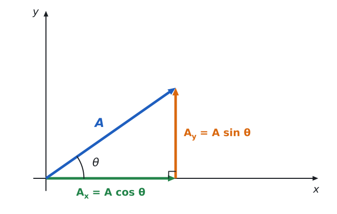
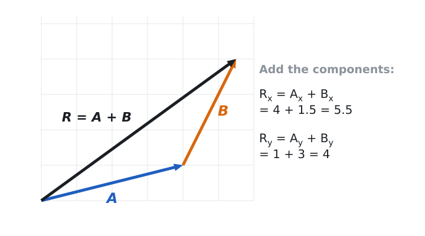
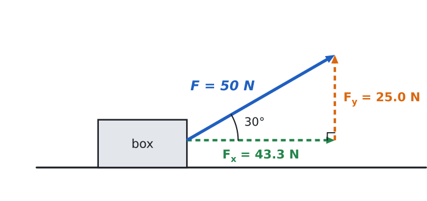

# 03 · Vectors and components

> **The one idea:** a slanted arrow can be swapped for two ordinary numbers, how far it reaches along $x$ and how far along $y$. That turns every slanted problem into two easy straight-line problems.

## Session plan (30 min)

| Min | What to do |
|---|---|
| 0–3 | **Warm-up** (below) |
| 3–13 | **Read** sections 1–4 |
| 13–19 | **Worked examples** (section 5): cover the solution, try it, then compare |
| 19–28 | **Practice**: problems 1, 3, 6 and 8 in the [problem set](practice/03-vectors-and-components-problems.md) |
| 28–30 | **Self-check** (section 7); note anything that felt shaky |

**Warm-up (from lesson 02).** In a right triangle the hypotenuse is 10 and one angle is 30°. How long is the side *opposite* that angle? *(Answer: 5, because $\sin 30° = \tfrac12$.)*

---

## 1. Where this fits

- **Before:** you can use sine, cosine and tangent in a right triangle (lesson 02).
- **Now:** a vector's components *are* a right triangle, so you already have the tools.
- **After:** forces on a ramp, projectile motion, anything "two-dimensional". Every one starts by splitting a vector into components.

## 2. The idea, explained

**Scalars and vectors.** A *scalar* is an amount with a unit: a mass of 3 kg, a time of 5 s, a speed of 20 m/s. A *vector* also has a **direction**: a velocity of 20 m/s *east*, a force of 50 N *30° above the horizontal*. We draw a vector as an arrow. The length shows the size (the *magnitude*) and the arrowhead shows the direction. In print, $\vec{A}$ is the vector and $A$ is its magnitude.

**Components.** Choose axes ($x$ to the right, $y$ up). Any vector can be replaced by two *perpendicular* vectors, one along each axis, that together do exactly the same job. These are its components. Drop a line from the arrow's tip to the $x$-axis and you get a right triangle with the vector as its hypotenuse:

*Reading it: the green arrow is how far $\vec A$ reaches along $x$, the orange arrow how far along $y$. Green then orange gets you to the same tip as the blue arrow.*

From the triangle (lesson 02):

$$A_x = A\cos\theta \qquad\qquad A_y = A\sin\theta$$

> **Rule of thumb.** The component *touching* the angle gets cosine. The component *across from* the angle gets sine. If the angle is measured from the $y$-axis instead, the two swap.

**Signs.** Components are signed numbers. Pointing left makes $A_x$ negative; pointing down makes $A_y$ negative. Easiest method: find the size using a positive angle, then decide the sign by looking at your sketch.

**Rebuilding a vector from its components.** Pythagoras gives the size and tangent gives the angle:

$$A = \sqrt{A_x^2 + A_y^2} \qquad\qquad \theta = \tan^{-1}\!\left(\frac{A_y}{A_x}\right)$$

A calculator's $\tan^{-1}$ only returns angles between −90° and 90°, so always check the quadrant with a sketch (trap 5).

**Adding vectors.** Graphically, put the second arrow's tail at the first arrow's tip. The sum $\vec R$ runs from the first tail to the last tip. Algebraically, **add the components**:

$$R_x = A_x + B_x \qquad\qquad R_y = A_y + B_y$$

Magnitudes do **not** add (unless the vectors point the same way). A 4 m walk followed by a 3 m walk at right angles leaves you 5 m from the start, not 7 m.

## 3. Formulas

| Formula | What it says | Use it when |
|---|---|---|
| $A_x = A\cos\theta$ | $x$-component, with $\theta$ measured from the $+x$ axis | you know the size and the angle |
| $A_y = A\sin\theta$ | $y$-component | you know the size and the angle |
| $A = \sqrt{A_x^2 + A_y^2}$ | size of the vector | you know the components |
| $\theta = \tan^{-1}(A_y/A_x)$ | direction (check the quadrant) | you know the components |
| $R_x = A_x + B_x$, $R_y = A_y + B_y$ | components of the sum | adding vectors (for $\vec A - \vec B$ flip the signs of $\vec B$ first) |

## 4. Common traps

1. **Calculator in radian mode.** $\cos 30°$ must give 0.866. If you see 0.154, switch to degrees.
2. **Swapping sine and cosine.** Always sketch the triangle. Quick test: as $\theta \to 0$ the vector lies along $x$, so $A_x \to A$. Only cosine does that ($\cos 0° = 1$).
3. **Forgetting signs.** A vector pointing left or down has a negative component.
4. **Adding magnitudes.** $R \neq A + B$. Add *components*, then rebuild.
5. **Trusting $\tan^{-1}$ blindly.** For components $(-6, +8)$ a calculator gives $\tan^{-1}\!\left(\tfrac{8}{-6}\right) = -53°$, but the vector points up and to the left (127° from $+x$).

## 5. Worked examples

### Example 1: Resolve a force *(type A)*

A rope pulls a box with a force of 50 N at 30° above the horizontal. Find the horizontal and vertical components.

1. **Draw and define.** $F = 50$ N, $\theta = 30°$ measured from the horizontal ($x$ direction).
2. **Choose.** The angle is from the horizontal, so $F_x$ touches it (cosine) and $F_y$ is across from it (sine).
3. **Solve.**
   - $F_x = 50\cos 30° = 50(0.866) = 43.3$ N
   - $F_y = 50\sin 30° = 50(0.500) = 25.0$ N
4. **Check.** Both components are smaller than 50 N ✓. And $\sqrt{43.3^2 + 25.0^2} = 50$ N ✓.

*(Why it will matter: in Unit 2 you'll see that only $F_x$ drags the box forward, while $F_y$ partly lifts it.)*

### Example 2: Add two vectors *(type C, then B)*

A hiker walks 8.0 km east, then 6.0 km north. How far is she from the start, and in what direction?

1. **Define.** East is $+x$, north is $+y$. $\vec A = (8.0,\ 0)$ km and $\vec B = (0,\ 6.0)$ km.
2. **Add the components.** $R_x = 8.0 + 0 = 8.0$ km and $R_y = 0 + 6.0 = 6.0$ km.
3. **Rebuild.** $R = \sqrt{8.0^2 + 6.0^2} = 10.0$ km, and $\theta = \tan^{-1}(6.0/8.0) = 36.9°$ north of east.
4. **Check.** $10.0 < 8.0 + 6.0 = 14.0$ ✓. The straight line is shorter than the walk.

## 6. Problem types and how to approach each

### Type A: Resolve (size and angle → components)

**You'll recognize it:** "a force of 20 N at 40° above the horizontal", "launched at 15 m/s at 60°".

**Approach:**
1. Sketch the vector and the axes. Mark the angle **and what it is measured from**.
2. Draw the right triangle. The side touching the angle gets cosine, the side across gets sine.
3. Compute each size as a positive number.
4. Add the signs from the sketch (left and down are negative).
5. Check that each component is no longer than the vector.

### Type B: Rebuild (components → size and direction)

**You'll recognize it:** components are given and you need "how fast" or "which way".

**Approach:**
1. Sketch the two components head to tail so you can see which quadrant the vector points into.
2. Size: $\sqrt{A_x^2 + A_y^2}$.
3. Reference angle: $\tan^{-1}\!\big(\lvert A_y\rvert / \lvert A_x\rvert\big)$, always between 0° and 90°.
4. Place the angle using your sketch and state it clearly, for example "53° above the $-x$ axis" or "127° from $+x$".
5. Check that the size is larger than either component.

### Type C: Add or subtract by components

**You'll recognize it:** two or more vectors are combined ("then", "net", "resultant").

**Approach:** build a small table.

| | $x$ | $y$ |
|---|---|---|
| $\vec A$ | | |
| $\vec B$ | | |
| **sum** | | |

1. Resolve each vector (type A) and fill in its row.
2. Add each column on its own. For $\vec A - \vec B$, flip the signs of $\vec B$'s row first.
3. Rebuild the result (type B).

### Type D: Qualitative reasoning and limiting cases

**You'll recognize it:** no numbers, or "what happens as the angle increases?", "is it possible that...?"

**Approach:**
1. Write $A_x = A\cos\theta$ and $A_y = A\sin\theta$.
2. Test the extremes: $\theta = 0°$ and $\theta = 90°$.
3. Use the shapes: cosine falls from 1 to 0 as $\theta$ goes from 0° to 90°; sine rises from 0 to 1.
4. Answer in a sentence with the reason.

*Mini-example:* for a vector at 20° above horizontal, which is larger, $A_x$ or $A_y$? The angle is small, so the vector is mostly horizontal and $A_x$ is larger. (Check: $\cos 20° = 0.94$, $\sin 20° = 0.34$.)

## 7. Self-check

1. If the angle is measured from the **$y$-axis**, which function gives $A_x$?
2. True or false: $\lvert\vec A + \vec B\rvert = A + B$ always.
3. A vector has $A_x = -3$ and $A_y = +4$. What is its size, and into which quadrant does it point?

*(Answers are at the end of the [solutions file](practice/03-vectors-and-components-solutions.md).)*

## 8. Recap and what's next

- A vector is a size plus a direction. Its components are its "shadows" on the axes.
- **Resolve:** cosine next to the angle, sine across from it, signs from the sketch. **Rebuild:** Pythagoras plus $\tan^{-1}$ with a quadrant check. **Add:** add components, never magnitudes.
- **Next:** *04 · Graphs: slope and area*, the other tool Unit 1 leans on.
