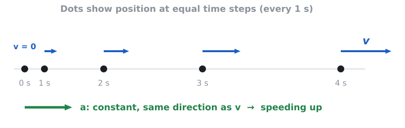
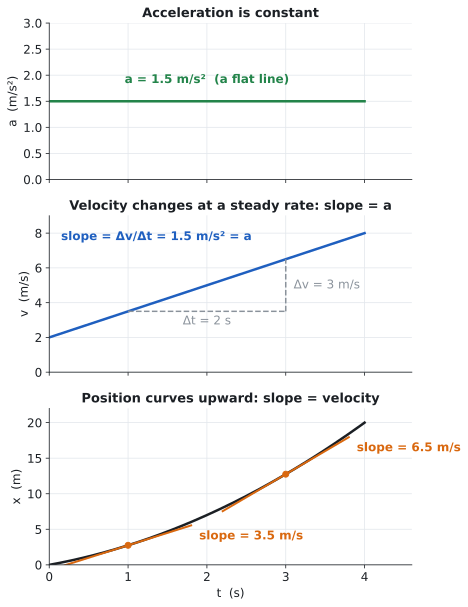
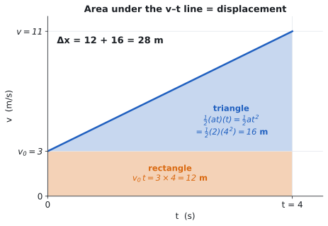

# 04 · Constant acceleration

> **The one idea:** when the acceleration is constant, the velocity changes by the same amount every second, and three equations let you find anything about the motion from any three known quantities.

## Session plan (30 min)

| Min | What to do |
|---|---|
| 0–3 | **Warm-up** (below) |
| 3–13 | **Read** sections 1–4 |
| 13–19 | **Worked examples** (section 5): cover the solution, try it, then compare |
| 19–28 | **Practice**: problems 2, 4, 5 and 6 in the [problem set](practice/04-constant-acceleration-problems.md) |
| 28–30 | **Self-check** (section 7); note anything that felt shaky |

**Warm-up (from lessons 02–03).**
1. A car's velocity changes from 10 m/s to 16 m/s in 3 s. What is its average acceleration? *(2 m/s²: $\Delta v/\Delta t = 6/3$.)*
2. On a velocity–time graph, what do the slope and the area under the line mean? *(Slope is acceleration; area is displacement.)*

---

## 1. Where this fits

- **Before:** you know the definitions of displacement, velocity and acceleration, and how to read motion graphs.
- **Now:** the special case where acceleration does *not* change. It gives three equations that solve a huge range of problems.
- **After:** free fall is exactly this with $a = -g$. Projectile motion uses these equations twice, once for $x$ and once for $y$. In Unit 2, Newton's second law will tell you *why* the acceleration has the value it does.

## 2. The idea, explained

**What "constant acceleration" means.** Every second, the velocity changes by the same amount. A car whose speed reads 2, 4, 6, 8 m/s on successive seconds has a constant acceleration of 2 m/s². Many real motions are close to this: a car pulling away gently or braking steadily, and anything falling near Earth's surface.

*Reading it: the dots are positions at equal time steps. The gaps grow because the object is faster each step. The velocity arrows grow by the same amount each step, which is what constant acceleration looks like.*

**Three graphs, one story.** The same motion drawn three ways:

- **$a$–$t$:** a flat line. The acceleration does not change.
- **$v$–$t$:** a straight line. Its **slope is the acceleration**.
- **$x$–$t$:** a curve (a parabola). Its **slope at any moment is the velocity**, and it steepens because the velocity keeps growing.

**Where the equations come from.** On a $v$–$t$ graph the **area under the line is the displacement**. Take an object that starts at velocity $v_{x0}$ and speeds up steadily for a time $t$:

*Reading it: the area under the line splits into a rectangle ($v_{x0}\,t$, what the object would cover at its starting speed) and a triangle ($\tfrac12 a_x t^2$, the extra distance gained by speeding up).*

The rectangle is $v_{x0}\,t$. The triangle has height $a_x t$ (the total gain in velocity) and width $t$, so its area is $\tfrac12 (a_x t)(t)$. Adding them:

$$\Delta x = v_{x0}\,t + \tfrac{1}{2}a_x t^2$$

The velocity equation is just the definition of acceleration, $a_x = \dfrac{v_x - v_{x0}}{t}$, rearranged:

$$v_x = v_{x0} + a_x t$$

For the third, notice that the whole shape is a trapezoid, so $\Delta x = \tfrac12 (v_{x0} + v_x)\,t$. Replace $t$ with $\dfrac{v_x - v_{x0}}{a_x}$ and simplify:

$$v_x^2 = v_{x0}^2 + 2a_x\,\Delta x$$

**Signs.** Choose which direction is positive, then keep it. $v_x$, $a_x$ and $\Delta x$ are all signed. A car moving in $+x$ that brakes has a *negative* $a_x$.

## 3. Formulas

Five quantities appear: $\Delta x$ (displacement), $v_{x0}$ (initial velocity), $v_x$ (final velocity), $a_x$ (acceleration) and $t$ (time). Each equation leaves one of them out.

| Equation | Leaves out | Use it when you don't have or want... |
|---|---|---|
| $a_x = \dfrac{\Delta v_x}{\Delta t}$ | (definition) | reading a $v$–$t$ slope; any average acceleration |
| $v_x = v_{x0} + a_x t$ | $\Delta x$ | displacement |
| $x = x_0 + v_{x0}t + \tfrac12 a_x t^2$ | $v_x$ | final velocity |
| $v_x^2 = v_{x0}^2 + 2a_x(x - x_0)$ | $t$ | time |
| $\Delta x = \tfrac12(v_{x0} + v_x)\,t$ | $a_x$ | acceleration (handy for checking) |

**The picking trick:** list the three quantities you know and the one you want. The fifth quantity, the one you neither know nor want, tells you which equation to use: pick the equation that leaves it out.

## 4. Common traps

1. **"Zero velocity means zero acceleration."** Not so. A ball at the top of a throw has $v = 0$ for an instant, but its velocity is still changing, so $a \neq 0$.
2. **"Negative acceleration means slowing down."** Negative only means "pointing in the $-x$ direction". An object slows down when $a$ and $v$ have **opposite** signs. A car moving in $-x$ with negative $a$ is speeding up.
3. **Using these equations when $a$ changes.** They only work while $a$ is constant. If it changes (speeds up *then* brakes), split the motion into stages.
4. **Distance versus displacement.** The equations give the signed displacement $\Delta x$. If the object turns around, the distance travelled is larger than $\lvert\Delta x\rvert$ (see problem 9).
5. **Restarting from zero.** In a later stage, the initial velocity is the *final velocity of the stage before*, not 0.

## 5. Worked examples

### Example 1: Pick the equation *(type A)*

A car moving at 8 m/s speeds up at 2 m/s² for 5 s. Find its final speed and its displacement.

1. **Draw.** Car moving right; right is $+x$.
2. **Define.** $v_{x0} = +8$ m/s, $a_x = +2$ m/s², $t = 5$ s. Unknowns: $v_x$ and $\Delta x$.
3. **Choose.** $v_x = v_{x0} + a_x t$ for the speed; $\Delta x = v_{x0}t + \tfrac12 a_x t^2$ for the displacement.
4. **Solve.**
   - $v_x = 8 + (2)(5) = 18$ m/s
   - $\Delta x = (8)(5) + \tfrac12(2)(5)^2 = 40 + 25 = 65$ m
5. **Check.** Use the equation that leaves out $a$: $\Delta x = \tfrac12(8 + 18)(5) = 65$ m ✓.

### Example 2: Braking to a stop, no time given *(type A)*

A car travelling at 20 m/s brakes with a constant acceleration of $-5$ m/s² until it stops. How far does it go, and how long does it take?

1. **Define.** $v_{x0} = +20$ m/s, $v_x = 0$, $a_x = -5$ m/s². Unknowns: $\Delta x$ and $t$.
2. **Choose.** For $\Delta x$, time is not given, so use the equation without $t$: $v_x^2 = v_{x0}^2 + 2a_x\,\Delta x$.
3. **Solve.**
   - $\Delta x = \dfrac{0 - 20^2}{2(-5)} = 40$ m
   - Then $t = \dfrac{v_x - v_{x0}}{a_x} = \dfrac{0 - 20}{-5} = 4$ s
4. **Check.** Average speed during braking is $(20 + 0)/2 = 10$ m/s. $10 \times 4 = 40$ m ✓.

## 6. Problem types and how to approach each

### Type A: Pick the equation (quantitative)

**You'll recognize it:** constant acceleration is stated or obvious, and three of the five quantities are known.

**Approach:**
1. Draw it and set a positive direction.
2. Make a table of the five quantities: fill in the knowns **with signs**, mark the unknown "?", and cross out the one you neither know nor want.
3. Pick the equation that leaves out the crossed-out quantity. Solve in symbols first.
4. Substitute with units.
5. Check with a different equation, for example the average-velocity one.

### Type B: Two-stage motion

**You'll recognize it:** "then", or an acceleration that changes (speeds up, *then* brakes).

**Approach:**
1. Draw a timeline and mark where the acceleration changes.
2. Do each stage with its own table of knowns.
3. **The final velocity of stage 1 is the initial velocity of stage 2.**
4. Add the stage displacements and the stage times to get the totals.

### Type C: Graph reading

**You'll recognize it:** a $v$–$t$ graph is given.

**Approach:**
1. For each straight segment, **slope = acceleration** (rise over run, with units).
2. A flat segment means $a = 0$.
3. **Area between the line and the time axis = displacement.** Split into triangles and rectangles. Area below the axis counts as negative displacement.
4. Check the units: (m/s) × s = m.

### Type D: Qualitative scaling

**You'll recognize it:** "if the initial speed is doubled...", "how does it compare...?"

**Approach:**
1. Choose the equation that connects the quantities in question.
2. **State what is held fixed** (for example, "the same brakes, so the same $a$").
3. See how the unknown depends on what changed, and scale it. For braking to a stop, $\Delta x = -v_{x0}^2/(2a_x)$, so $\Delta x \propto v_{x0}^2$: doubling the speed means four times the distance.
4. Answer in a sentence that includes the reason.

### Type E: Experimental analysis

**You'll recognize it:** a data table, or "what should the student plot?"

**Approach:**
1. Write the equation for the situation. Starting from rest: $x = \tfrac12 a t^2$.
2. **Linearize:** choose axes so the equation becomes $y = (\text{slope})\,u$. Here, plot $x$ against $t^2$.
3. The slope equals $\tfrac12 a$, so $a = 2 \times \text{slope}$.
4. Use a best-fit line through *all* the points, not one data point; it averages out the measurement errors.

## 7. Self-check

1. Which of the constant-acceleration equations contains no time?
2. A car moving in the $-x$ direction has a negative $a_x$. Is it speeding up or slowing down?
3. On a $v$–$t$ graph, what do the slope and the area under the line represent?
4. An object has a constant acceleration of 3 m/s². By how much does its velocity change each second?

*(Answers are at the end of the [solutions file](practice/04-constant-acceleration-solutions.md).)*

## 8. Recap and what's next

- Constant acceleration means a straight $v$–$t$ line. Slope is $a$, area is $\Delta x$.
- Three equations, each missing one of $\Delta x, v_{x0}, v_x, a_x, t$. Pick the one that leaves out what you neither know nor want.
- Split motion into stages when the acceleration changes, and keep your signs.
- **Next:** *05 · Free fall*, the same equations with $a_x$ replaced by $a_y = -g$.
