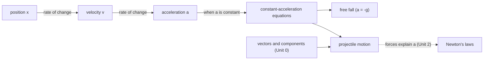

# Unit 1 · Kinematics

**Kinematics is the language for *describing* motion** (where, how fast, how quickly the speed changes) without asking *why* it moves. The "why" starts in Unit 2. Everything later builds on the three quantities here: position, velocity, acceleration.

| # | Lesson | College Board topic | Status |
|---|---|---|---|
| 01 | Scalars, vectors and displacement | 1.1 | planned |
| 02 | Velocity and acceleration | 1.2 | planned |
| 03 | Representing motion: graphs and motion diagrams | 1.3 | planned |
| 04 | [Constant acceleration](04-constant-acceleration.md) | 1.2, 1.3 | ✅ written |
| 05 | Free fall | 1.2 | planned |
| 06 | Reference frames and relative motion | 1.4 | planned |
| 07 | Vectors and motion in two dimensions | 1.5 | planned |
| 08 | Projectile motion | 1.5 | planned |

**Prerequisites:** [Unit 0](../00-math-refresher/README.md), especially vectors and components and graphs.
