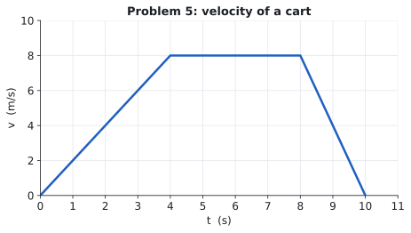

# Practice · 04 · Constant acceleration

★ = do these in the 30-minute session. Take positive $x$ in the direction of the initial motion unless told otherwise. Try each one yourself before you open the [solutions](04-constant-acceleration-solutions.md).

---

### 1 *(Type A: pick the equation)*

A cyclist speeds up uniformly from 4.0 m/s to 10.0 m/s in 3.0 s. Find her acceleration and the distance she covers in that time.

### 2 ★ *(Type A: pick the equation)*

A car starts from rest and accelerates at 3.0 m/s² over a distance of 150 m. How fast is it going at the end, and how long did that take?

### 3 *(Type A: braking)*

A train travelling at 30 m/s brakes with a constant deceleration of 1.5 m/s². How far does it travel before stopping, and how long does that take?

### 4 ★ *(Type B: two-stage motion)*

A car moving at 10 m/s speeds up at 2.0 m/s² for 6.0 s, then brakes at 4.0 m/s² until it stops. Find the total distance it travels and the total time.

### 5 ★ *(Type C: graph reading)*

(a) Find the acceleration of the cart during 0–4 s, 4–8 s and 8–10 s.
(b) Find the cart's total displacement over the 10 s.
(c) Find its average velocity over the 10 s.

### 6 ★ *(Type D: qualitative scaling)*

A car brakes from 20 m/s to a stop in 40 m. Suppose it is travelling at **40 m/s** instead and brakes just as hard (the same deceleration).

(a) By what factor does the stopping *distance* change? Explain.
(b) By what factor does the stopping *time* change? Explain.
(c) Give the new distance and time.

### 7 *(Type D: qualitative scaling)*

Two carts, A and B, start from rest on a track. B's acceleration is twice A's.

(a) After the same **time**, how do their speeds and their distances compare?
(b) After travelling the same **distance**, how do their speeds compare?

### 8 *(Type E: experimental analysis)*

A cart starts from rest and speeds up steadily down a track. A student records its position at several times:

| $t$ (s) | 0.5 | 1.0 | 1.5 | 2.0 |
|---|---|---|---|---|
| $x$ (m) | 0.10 | 0.40 | 0.90 | 1.60 |

(a) What two quantities should be graphed to get a straight line?
(b) What does the slope of that line represent?
(c) Use the data to find the cart's acceleration.
(d) Why is a best-fit line through all the points better than using one data point?

### 9 *(Type A: signs and turning around)*

A cart moving in the $+x$ direction at 12 m/s has a constant acceleration of $-3.0$ m/s².

(a) Find its velocity at $t = 2.0$ s and at $t = 6.0$ s.
(b) Find its displacement over the first 6.0 s.
(c) Find the **distance** it travels in those 6.0 s. Why does it differ from (b)?
